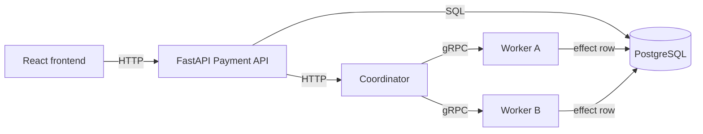

# PaySafe

PaySafe is a college distributed-systems mini-project. It simulates a payment flowing through independent services: a React dashboard, a FastAPI payment API, a coordinator, two payment workers, and PostgreSQL.

Payments are **simulated**. No bank, UPI service, or payment gateway is contacted, and no real money is transferred. This is not a production payment system.

## Architecture



The browser talks to FastAPI over HTTP. FastAPI stores the payment and asks the coordinator to process it. The coordinator calls one of the workers with gRPC. The worker simulates processing and returns a result. FastAPI saves that result in PostgreSQL and shows it on the dashboard.

In this phase the API-to-coordinator call is HTTP. Coordinator-to-worker calls are real gRPC, defined in `proto/payment.proto`.

## Service roles

| Service | Role |
| --- | --- |
| Frontend | Payment form, latest result, recent transactions, and worker reachability. |
| Payment API | Validates the amount and description, creates the payment row, calls the coordinator, and stores the final status. |
| Coordinator | Chooses a worker in round-robin order and calls it over gRPC. If that call cannot connect or exceeds its deadline, it tries the other worker and then retries a bounded number of times. |
| Worker A and Worker B | The same Python worker process, started twice with different `WORKER_ID` values. Each one records a simulated effect in PostgreSQL before doing that work again. |
| PostgreSQL | Shared store for payment records, worker effect rows, and the development fault switches. |

## Payment statuses

| Status | Meaning |
| --- | --- |
| `PENDING` | The row has been inserted and has not been sent yet. This is usually too brief to see. |
| `PROCESSING` | The API is waiting on the coordinator, or the coordinator's response was lost. |
| `SUCCESS` | A worker finished the simulated payment. |
| `FAILED` | A worker confirmed a simulated processing failure, or no worker could be contacted and none of them recorded an effect. |
| `UNKNOWN` | A worker was called, but a timeout or interruption means the result is not confirmed. This is not a failed payment. |

A timeout does **not** mark the payment as `FAILED`. If the API never hears back from the coordinator, the row stays `PROCESSING`. If the coordinator itself hits a worker deadline and still has no final result, it returns `UNKNOWN`. After a `PROCESSING` row is older than `PROCESSING_STALE_SECONDS` (30 seconds by default), reconciliation can flag it. A later reconciliation run copies a finished worker effect onto the payment, or marks a flagged row `UNKNOWN` when no effect exists. It does not send the payment to a worker again.

## Idempotency and reconciliation

`POST /api/payments` accepts an optional `Idempotency-Key` header. The dashboard sends one automatically.

A key must be 8 to 128 characters and may contain only letters, numbers, underscores, and hyphens. An empty or malformed key returns HTTP 422. Omitting the header keeps the Phase 1 behavior: every submission creates a new payment.

The API stores a fingerprint of the normalized amount and description. Normalization treats `12.5` and `12.50` as the same amount.

| Request | Result |
| --- | --- |
| New key | One payment is created and sent to the coordinator. |
| Same key and same amount and description, already `SUCCESS` or `FAILED` | HTTP 200 with the stored payment. The coordinator is not called again. |
| Same key and same payload, still `PENDING` or `PROCESSING` | HTTP 200 with that payment. The coordinator is not called again. |
| Same key with a different amount or description | HTTP 409. |
| No key | A new payment is created, as in Phase 1. |

The key is unique in PostgreSQL. Two overlapping requests with the same key cannot insert two rows.

Flag stale processing payments with:

```powershell
Invoke-RestMethod -Method Post http://localhost:8000/api/admin/reconcile
```

This demo route has **no authentication**. It does three things, in order:

1. If a worker effect row already says `SUCCESS` or `FAILED`, copy that onto a `PROCESSING` or `UNKNOWN` payment.
2. Flag `PROCESSING` rows older than the threshold with `reconciliation_required`.
3. Change a flagged `PROCESSING` row to `UNKNOWN` when no terminal worker effect exists.

It does not change payments that are already `SUCCESS` or `FAILED`, does not mark an uncertain payment failed, and does not call a worker. Running it again does not create a second effect.

An idempotency key prevents a second API dispatch for the same client submission. Separately, a worker stores one effect row per transaction id, so a retry of that same id does not apply the simulated effect twice. This is not exactly-once execution across every distributed failure. If a worker claims the effect and stops before recording `SUCCESS` or `FAILED`, the payment stays uncertain until reconciliation, and the effect is not run again automatically.

## Technologies

- React, TypeScript, Vite, and Tailwind CSS
- Python, FastAPI, gRPC, and Protocol Buffers
- PostgreSQL, SQLAlchemy, and Alembic
- Docker Compose
- pytest

## Prerequisites

- Docker Desktop with Docker Compose v2
- Python 3.12 or newer, only if you want to run the tests on the host
- Node.js is not required on the host when you use Docker for the frontend

## Setup

From the project root:

```powershell
docker compose up --build
```

The compose file already uses local demonstration defaults, so copying `.env.example` is optional. Copy it to `.env` only when you want to override those values. Keep `DATABASE_URL` consistent with `POSTGRES_USER`, `POSTGRES_PASSWORD`, and `POSTGRES_DB`.

The `.env.example` values are local defaults, not production credentials.

When the containers are healthy, open:

- Dashboard: [http://localhost:8080](http://localhost:8080)
- API docs: [http://localhost:8000/docs](http://localhost:8000/docs)
- PostgreSQL: `localhost:5432`, database `paysafe`, user `paysafe`, password `paysafe`

Stop the application:

```powershell
docker compose down
```

Stop it and delete the database volume:

```powershell
docker compose down -v
```

Follow the coordinator and worker logs while you submit a payment:

```powershell
docker compose logs -f coordinator worker-a worker-b api
```

## Submit a test payment

1. Open [http://localhost:8080](http://localhost:8080).
2. Enter an amount such as `25.00` and a description such as `Course registration fee`.
3. Choose **Submit payment**.
4. The result card shows the transaction ID, `SUCCESS`, the amount, and either `worker-a` or `worker-b`.
5. The same payment appears in **Recent transactions**.
6. Submit a second payment with a new description. The dashboard uses a new idempotency key, and the coordinator gives it to the other worker. If a payment stays processing, submit the same amount and description again: the same key is reused and the existing transaction is returned.

You can also call the API directly:

```powershell
Invoke-RestMethod -Method Post -Uri http://localhost:8000/api/payments -ContentType "application/json" -Headers @{"Idempotency-Key"="demo-key-01"} -Body '{"amount":"42.50","description":"Class demo"}'
Invoke-RestMethod -Method Post -Uri http://localhost:8000/api/payments -ContentType "application/json" -Headers @{"Idempotency-Key"="demo-key-01"} -Body '{"amount":"42.50","description":"Class demo"}'
Invoke-RestMethod -Method Post http://localhost:8000/api/admin/reconcile
```

## Fault Tolerance Demonstration

The default path is unchanged: with both workers healthy and their fault switches at `normal`, a simulated payment succeeds.

The coordinator allows `WORKER_MAX_ATTEMPTS` attempts (default 2), including the first. Each worker RPC times out after `GRPC_TIMEOUT_SECONDS` (default 5). There is a `WORKER_RETRY_DELAY_SECONDS` pause between attempts (default 0.2). A connection failure or a deadline is retried. A worker status of `FAILED` is final and is not retried. A deadline that still has no final result becomes `UNKNOWN`.

Fault switches are development-only and have **no authentication**. `normal` resets a worker. `fail` makes that worker return a simulated processing failure. `delay` waits the given number of seconds before recording success. The dashboard buttons do the same thing. Delay is set to 8 seconds there, which is longer than the 5 second RPC timeout.

1. Start the stack and submit a payment while both workers are healthy. It should be `SUCCESS` on `worker-a` or `worker-b`.

```powershell
docker compose up --build -d
Invoke-RestMethod -Method Post -Uri http://localhost:8000/api/payments -ContentType "application/json" -Headers @{"Idempotency-Key"="demo-phase3-ok"} -Body '{"amount":"21.00","description":"Healthy payment"}'
```

2. Stop one worker.

```powershell
docker stop paysafe-worker-a-1
```

3. Submit another payment. The coordinator should use the remaining worker. The transaction id is new because this is a new idempotency key.

```powershell
Invoke-RestMethod -Method Post -Uri http://localhost:8000/api/payments -ContentType "application/json" -Headers @{"Idempotency-Key"="demo-phase3-failover"} -Body '{"amount":"22.00","description":"One worker down"}'
docker compose logs coordinator --tail 20
```

4. Start the stopped worker, then delay both workers for longer than the RPC timeout.

```powershell
docker start paysafe-worker-a-1
Invoke-RestMethod -Method Post -Uri http://localhost:8000/api/admin/faults -ContentType "application/json" -Body '{"worker_id":"worker-a","mode":"delay","delay_seconds":8}'
Invoke-RestMethod -Method Post -Uri http://localhost:8000/api/admin/faults -ContentType "application/json" -Body '{"worker_id":"worker-b","mode":"delay","delay_seconds":8}'
Invoke-RestMethod -Method Post -Uri http://localhost:8000/api/payments -ContentType "application/json" -Headers @{"Idempotency-Key"="demo-phase3-delay"} -Body '{"amount":"23.00","description":"Delayed workers"}'
```

5. That delayed payment is `UNKNOWN` when the deadline wins, or `SUCCESS` if a retry observes the recorded effect. `UNKNOWN` is not `FAILED`. The same idempotency key returns the same row and does not create a second payment.

```powershell
Invoke-RestMethod -Method Post -Uri http://localhost:8000/api/payments -ContentType "application/json" -Headers @{"Idempotency-Key"="demo-phase3-delay"} -Body '{"amount":"23.00","description":"Delayed workers"}'
```

6. Reset the fault switches. After the delayed worker has finished, reconciliation copies a recorded `SUCCESS` onto an `UNKNOWN` or `PROCESSING` row. It does not call a worker again.

```powershell
Invoke-RestMethod -Method Post -Uri http://localhost:8000/api/admin/faults -ContentType "application/json" -Body '{"worker_id":"worker-a","mode":"normal","delay_seconds":0}'
Invoke-RestMethod -Method Post -Uri http://localhost:8000/api/admin/faults -ContentType "application/json" -Body '{"worker_id":"worker-b","mode":"normal","delay_seconds":0}'
Invoke-RestMethod -Method Post http://localhost:8000/api/admin/reconcile
```

7. A definitive failure is different. Set a worker to `fail`, submit a new payment, and the status is `FAILED`. Repeating the same transaction does not insert a second effect row. Reset with `normal` when the demo is finished. To make the failure deterministic, set both workers to `fail`, because round-robin may choose either one.

```powershell
Invoke-RestMethod -Method Post -Uri http://localhost:8000/api/admin/faults -ContentType "application/json" -Body '{"worker_id":"worker-a","mode":"fail","delay_seconds":0}'
Invoke-RestMethod -Method Post -Uri http://localhost:8000/api/admin/faults -ContentType "application/json" -Body '{"worker_id":"worker-b","mode":"fail","delay_seconds":0}'
Invoke-RestMethod -Method Post -Uri http://localhost:8000/api/payments -ContentType "application/json" -Headers @{"Idempotency-Key"="demo-phase3-fail"} -Body '{"amount":"24.00","description":"Forced failure"}'
docker exec paysafe-postgres-1 psql -U paysafe -d paysafe -c "SELECT transaction_id, status, worker_id FROM worker_effects ORDER BY id;"
```

Stopping a container is the unavailable-worker case. The fault switch does not make health checks fail; a worker in `fail` or `delay` mode still reports itself as reachable.

## Tests

The automated tests use SQLite or an in-process gRPC server. They do not connect to the Docker database.

```powershell
cd backend
python -m venv .venv
.\.venv\Scripts\python -m pip install -r requirements.txt
.\.venv\Scripts\python scripts\generate_proto.py
.\.venv\Scripts\python -m pytest
```

`generate_proto.py` rewrites `backend/generated` from `proto/payment.proto`. The generated modules are checked in so a normal test run works after the dependencies are installed. Regenerate them if you change the proto file. The Docker image generates them again during the build.

## Project layout

```text
proto/payment.proto          gRPC contract
backend/api                  FastAPI payment API
backend/coordinator          round-robin coordinator
backend/worker               shared worker implementation
backend/paysafe              database models and validation
backend/alembic              schema migration
backend/tests                pytest suite
frontend                     React dashboard
docker-compose.yml           all six containers
```

## Phase 1 checks

These commands were run on this machine while implementing Phase 1:

- `python -m pytest` in `backend`: **33 passed**. One deprecation warning comes from Starlette's test client, not from PaySafe.
- `npm run build` in `frontend`: TypeScript and the Vite production build completed.
- `docker compose up --build`: PostgreSQL, both workers, the coordinator, the API, and the frontend reached a healthy or started state.
- A payment of `25.00` was stored as `SUCCESS` on `worker-a`, and the next payment of `10.50` was stored as `SUCCESS` on `worker-b`. Both rows were present in PostgreSQL.
- The dashboard at `http://localhost:8080` submitted `32.00` / `Library deposit` and showed transaction `TXN-444113E3F9F8`, status `SUCCESS`, and worker `worker-a`. The same row appeared in Recent transactions. Worker A and Worker B were both reported as reachable.
- Submitting amount `0` showed `Amount must be greater than 0.` and did not add a transaction.
- Coordinator and worker logs showed the gRPC handoff, for example `Routed TXN-A65A665BFD34 to worker-b` and `Processed TXN-A65A665BFD34`.

## Phase 2 checks

These commands were run on this machine while implementing Phase 2:

- `python -m pytest` in `backend`: **58 passed**. The same Starlette test-client warning remains. The suite uses SQLite, including an eight-thread check that one idempotency key inserts one row.
- `npm run build` in `frontend`: TypeScript and the Vite production build completed.
- `docker compose up --build -d`: the API applied Alembic revision `002_idempotency` and became healthy. PostgreSQL has `idempotency_key`, `request_fingerprint`, `reconciliation_required`, and unique index `ix_payments_idempotency_key`.
- A keyed payment of `42.50` / `Class demo` was stored once as `TXN-44059B0F910B` on `worker-a`. Repeating the same key, including amount `42.5`, returned that transaction and the same `updated_at`. The coordinator log contains one `Routed TXN-44059B0F910B to worker-a` line, and worker A logged one `Processed` line for it.
- The same key with amount `10.00` returned HTTP 409. A second key created `TXN-CBC1066D1E82` on `worker-b`.
- After that first row was aged back to `PROCESSING`, `POST /api/admin/reconcile` returned `marked: 1` for `TXN-44059B0F910B`. The status stayed `PROCESSING` and `reconciliation_required` became true. A second reconcile call returned `marked: 0`. No extra worker log line appeared.
- The dashboard at `http://localhost:8080` showed an idempotency key, submitted `18.00` / `Lab fee` as `TXN-79DFB2A57154` with status `SUCCESS`, then issued a new key. Recent transactions showed the aged Class demo row as `PROCESSING` with a Reconcile indicator. Both workers were reachable.

## Phase 3 checks

These commands were run on this machine while implementing Phase 3:

- `python -m pytest` in `backend`: **71 passed**. The same Starlette test-client warning remains. Phase 2 idempotency and reconciliation tests are included.
- `npm run build` in `frontend`: TypeScript and the Vite production build completed.
- `docker compose up --build -d`: the API applied Alembic revision `003_retries` and became healthy.
- `21.00` / `Healthy payment` with key `demo-phase3-ok` was stored once as `TXN-61FBB14F0A5B`, `SUCCESS`, `worker-a`, attempt 1. Repeating that key returned the same transaction and the same `updated_at`. `worker_effects` has one `SUCCESS` row for it.
- After `docker stop paysafe-worker-a-1`, `22.00` / `One worker down` was `TXN-8A5792B23804`, `SUCCESS`, `worker-b`, attempt 1. Worker A was started again and became healthy.
- With both workers set to an 8 second delay, `23.00` / `Delayed workers` returned `TXN-4F5C728B9C35` as `UNKNOWN` on attempt 2. Worker B logged two replays of that id as `PROCESSING`. Worker A logged one `Processed` line after the deadline. Repeating the same idempotency key returned that same `UNKNOWN` row. `POST /api/admin/reconcile` then resolved it to `SUCCESS` on `worker-a`. There is one effect row.
- With both workers set to `fail`, `24.00` / `Forced failure` was `TXN-2EFE63B3735A`, `FAILED`, `worker-a`, attempt 1, with one `FAILED` effect row. The fault switches were reset to `normal`.
- The dashboard showed the attempt count, a violet `UNKNOWN` badge for an older flagged payment that had no worker result, and a rose `FAILED` badge for the forced failure. Those two statuses are visually different.

## Limitations

- If no worker can be contacted and no effect row was recorded, the payment is stored as `FAILED`. If the API's own call to the coordinator times out, the row stays `PROCESSING`. If the coordinator sees a worker deadline and still has no final status, the payment is `UNKNOWN`.
- There is one coordinator. It does not run leader election, and the coordinator process itself does not fail over.
- Round-robin state lives in the coordinator process and starts again at Worker A after a restart.
- Lamport clocks, the event timeline, and worker-scaling experiments are later phases.
- gRPC inside the Compose network does not use TLS.
- The fault switches and the reconcile route have no authentication. They are for this demo only.
- One effect row per transaction id stops a second simulated effect. It does not prove exactly-once execution if the worker stops after claiming the row and before writing `SUCCESS` or `FAILED`. That payment stays uncertain, and the effect is not run again automatically.
