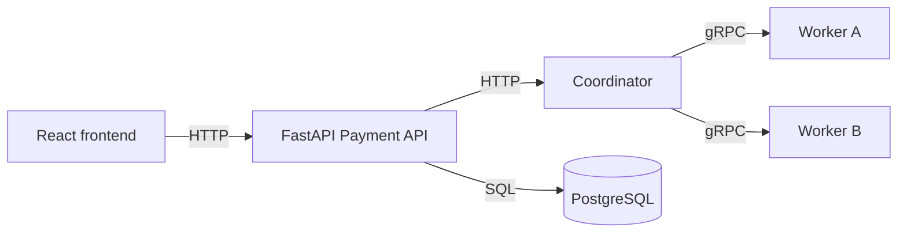

# PaySafe

PaySafe is a college distributed-systems mini-project. It simulates a payment flowing through independent services: a React dashboard, a FastAPI payment API, a coordinator, two payment workers, and PostgreSQL.

Payments are **simulated**. No bank, UPI service, or payment gateway is contacted, and no real money is transferred. This is not a production payment system.

## Architecture



The browser talks to FastAPI over HTTP. FastAPI stores the payment and asks the coordinator to process it. The coordinator calls one of the workers with gRPC. The worker simulates processing and returns a result. FastAPI saves that result in PostgreSQL and shows it on the dashboard.

In this phase the API-to-coordinator call is HTTP. Coordinator-to-worker calls are real gRPC, defined in `proto/payment.proto`.

## Service roles

| Service | Role |
| --- | --- |
| Frontend | Payment form, latest result, recent transactions, and worker reachability. |
| Payment API | Validates the amount and description, creates the payment row, calls the coordinator, and stores the final status. |
| Coordinator | Chooses a worker in round-robin order and calls it over gRPC. If that worker does not answer, it tries the other one. |
| Worker A and Worker B | The same Python worker process, started twice with different `WORKER_ID` values. Each one simulates a successful payment. |
| PostgreSQL | Shared store for payment records. The API is the service that writes those records in this phase. |

## Payment statuses

| Status | Meaning |
| --- | --- |
| `PENDING` | The row has been inserted and has not been sent yet. This is usually too brief to see. |
| `PROCESSING` | The API is waiting on the coordinator, or the coordinator's response was lost. |
| `SUCCESS` | A worker finished the simulated payment. |
| `FAILED` | No worker was reachable, or the coordinator could not be contacted before it accepted the request. |

A timeout does **not** mark the payment as `FAILED`. The row stays `PROCESSING` because the outcome is not known. After it stays in that state longer than `PROCESSING_STALE_SECONDS` (30 seconds by default), reconciliation can flag it without sending it to a worker again.

## Idempotency and reconciliation

`POST /api/payments` accepts an optional `Idempotency-Key` header. The dashboard sends one automatically.

A key must be 8 to 128 characters and may contain only letters, numbers, underscores, and hyphens. An empty or malformed key returns HTTP 422. Omitting the header keeps the Phase 1 behavior: every submission creates a new payment.

The API stores a fingerprint of the normalized amount and description. Normalization treats `12.5` and `12.50` as the same amount.

| Request | Result |
| --- | --- |
| New key | One payment is created and sent to the coordinator. |
| Same key and same amount and description, already `SUCCESS` or `FAILED` | HTTP 200 with the stored payment. The coordinator is not called again. |
| Same key and same payload, still `PENDING` or `PROCESSING` | HTTP 200 with that payment. The coordinator is not called again. |
| Same key with a different amount or description | HTTP 409. |
| No key | A new payment is created, as in Phase 1. |

The key is unique in PostgreSQL. Two overlapping requests with the same key cannot insert two rows.

Flag stale processing payments with:

```powershell
Invoke-RestMethod -Method Post http://localhost:8000/api/admin/reconcile
```

This demo route has **no authentication**. It only sets `reconciliation_required` on `PROCESSING` rows older than the threshold. It does not change `SUCCESS` or `FAILED` rows, does not mark a payment failed, and does not call a worker. Running it again does not change rows that are already flagged.

An idempotency key prevents a second API dispatch for the same client submission. It does **not** guarantee exactly-once worker execution. If a worker finishes and the response is lost, the payment stays `PROCESSING` until someone reconciles it. Worker-side deduplication is left for a later phase because the workers do not currently store payment state.

## Technologies

- React, TypeScript, Vite, and Tailwind CSS
- Python, FastAPI, gRPC, and Protocol Buffers
- PostgreSQL, SQLAlchemy, and Alembic
- Docker Compose
- pytest

## Prerequisites

- Docker Desktop with Docker Compose v2
- Python 3.12 or newer, only if you want to run the tests on the host
- Node.js is not required on the host when you use Docker for the frontend

## Setup

From the project root:

```powershell
docker compose up --build
```

The compose file already uses local demonstration defaults, so copying `.env.example` is optional. Copy it to `.env` only when you want to override those values. Keep `DATABASE_URL` consistent with `POSTGRES_USER`, `POSTGRES_PASSWORD`, and `POSTGRES_DB`.

The `.env.example` values are local defaults, not production credentials.

When the containers are healthy, open:

- Dashboard: [http://localhost:8080](http://localhost:8080)
- API docs: [http://localhost:8000/docs](http://localhost:8000/docs)
- PostgreSQL: `localhost:5432`, database `paysafe`, user `paysafe`, password `paysafe`

Stop the application:

```powershell
docker compose down
```

Stop it and delete the database volume:

```powershell
docker compose down -v
```

Follow the coordinator and worker logs while you submit a payment:

```powershell
docker compose logs -f coordinator worker-a worker-b api
```

## Submit a test payment

1. Open [http://localhost:8080](http://localhost:8080).
2. Enter an amount such as `25.00` and a description such as `Course registration fee`.
3. Choose **Submit payment**.
4. The result card shows the transaction ID, `SUCCESS`, the amount, and either `worker-a` or `worker-b`.
5. The same payment appears in **Recent transactions**.
6. Submit a second payment with a new description. The dashboard uses a new idempotency key, and the coordinator gives it to the other worker. If a payment stays processing, submit the same amount and description again: the same key is reused and the existing transaction is returned.

You can also call the API directly:

```powershell
Invoke-RestMethod -Method Post -Uri http://localhost:8000/api/payments -ContentType "application/json" -Headers @{"Idempotency-Key"="demo-key-01"} -Body '{"amount":"42.50","description":"Class demo"}'
Invoke-RestMethod -Method Post -Uri http://localhost:8000/api/payments -ContentType "application/json" -Headers @{"Idempotency-Key"="demo-key-01"} -Body '{"amount":"42.50","description":"Class demo"}'
Invoke-RestMethod -Method Post http://localhost:8000/api/admin/reconcile
```

## Tests

The automated tests use SQLite or an in-process gRPC server. They do not connect to the Docker database.

```powershell
cd backend
python -m venv .venv
.\.venv\Scripts\python -m pip install -r requirements.txt
.\.venv\Scripts\python scripts\generate_proto.py
.\.venv\Scripts\python -m pytest
```

`generate_proto.py` rewrites `backend/generated` from `proto/payment.proto`. The generated modules are checked in so a normal test run works after the dependencies are installed. Regenerate them if you change the proto file. The Docker image generates them again during the build.

## Project layout

```text
proto/payment.proto          gRPC contract
backend/api                  FastAPI payment API
backend/coordinator          round-robin coordinator
backend/worker               shared worker implementation
backend/paysafe              database models and validation
backend/alembic              schema migration
backend/tests                pytest suite
frontend                     React dashboard
docker-compose.yml           all six containers
```

## Phase 1 checks

These commands were run on this machine while implementing Phase 1:

- `python -m pytest` in `backend`: **33 passed**. One deprecation warning comes from Starlette's test client, not from PaySafe.
- `npm run build` in `frontend`: TypeScript and the Vite production build completed.
- `docker compose up --build`: PostgreSQL, both workers, the coordinator, the API, and the frontend reached a healthy or started state.
- A payment of `25.00` was stored as `SUCCESS` on `worker-a`, and the next payment of `10.50` was stored as `SUCCESS` on `worker-b`. Both rows were present in PostgreSQL.
- The dashboard at `http://localhost:8080` submitted `32.00` / `Library deposit` and showed transaction `TXN-444113E3F9F8`, status `SUCCESS`, and worker `worker-a`. The same row appeared in Recent transactions. Worker A and Worker B were both reported as reachable.
- Submitting amount `0` showed `Amount must be greater than 0.` and did not add a transaction.
- Coordinator and worker logs showed the gRPC handoff, for example `Routed TXN-A65A665BFD34 to worker-b` and `Processed TXN-A65A665BFD34`.

## Phase 2 checks

These commands were run on this machine while implementing Phase 2:

- `python -m pytest` in `backend`: **58 passed**. The same Starlette test-client warning remains. The suite uses SQLite, including an eight-thread check that one idempotency key inserts one row.
- `npm run build` in `frontend`: TypeScript and the Vite production build completed.
- `docker compose up --build -d`: the API applied Alembic revision `002_idempotency` and became healthy. PostgreSQL has `idempotency_key`, `request_fingerprint`, `reconciliation_required`, and unique index `ix_payments_idempotency_key`.
- A keyed payment of `42.50` / `Class demo` was stored once as `TXN-44059B0F910B` on `worker-a`. Repeating the same key, including amount `42.5`, returned that transaction and the same `updated_at`. The coordinator log contains one `Routed TXN-44059B0F910B to worker-a` line, and worker A logged one `Processed` line for it.
- The same key with amount `10.00` returned HTTP 409. A second key created `TXN-CBC1066D1E82` on `worker-b`.
- After that first row was aged back to `PROCESSING`, `POST /api/admin/reconcile` returned `marked: 1` for `TXN-44059B0F910B`. The status stayed `PROCESSING` and `reconciliation_required` became true. A second reconcile call returned `marked: 0`. No extra worker log line appeared.
- The dashboard at `http://localhost:8080` showed an idempotency key, submitted `18.00` / `Lab fee` as `TXN-79DFB2A57154` with status `SUCCESS`, then issued a new key. Recent transactions showed the aged Class demo row as `PROCESSING` with a Reconcile indicator. Both workers were reachable.

## Phase 1 limitations

- If the coordinator connection is refused, the payment is stored as `FAILED` because the coordinator never accepted it. If the call times out, it stays `PROCESSING`.
- There is one coordinator. It does not run leader election, and it does not fail over.
- Round-robin state lives in the coordinator process and starts again at Worker A after a restart.
- Lamport clocks, the event timeline, and worker-scaling experiments are later phases.
- gRPC inside the Compose network does not use TLS.
- Worker failure buttons and delay injection are not part of this phase. A worker that is down is reported as unreachable, and the coordinator tries the other worker.
- API idempotency does not prove that a worker executed a payment only once when its response was lost.
